## Calibration Overview

**Model:** SimCRC — Adenoma (Female), Chilean population

**Version:** v0.15.0 · Calibrated September 21, 2026 (run `v0.15.0.20260921.1018`)

**Method:** BayCANN (Bayesian Calibration with Artificial Neural Networks)

::: incremental
- Priors derived from the **US model**, adjusted per Nicolas' suggestions
- Modified parameters: `alpha_lesion_adenoma`, hazard rates, preclinical-to-clinical detection probabilities
- Calibration targets from **Chilean epidemiological data**
- **4 MCMC chains** used for posterior sampling
:::

------------------------------------------------------------------------

## Prior Ranges — Chile vs USA {.smaller}

USA = calibration run v0.13.0.20260313.2334. Slides 15 and 16 use the published US model, v0.13.0.1.

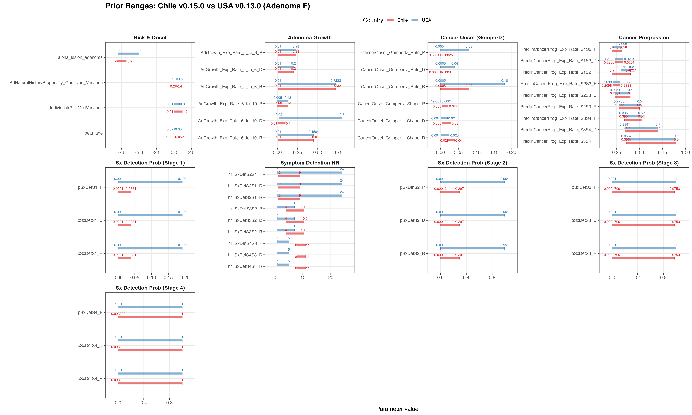{fig-align="center" width="95%"}

------------------------------------------------------------------------

## Posterior Distributions — Chile vs USA {.smaller}

USA = calibration run v0.13.0.20260313.2334. Slides 15 and 16 use the published US model, v0.13.0.1.

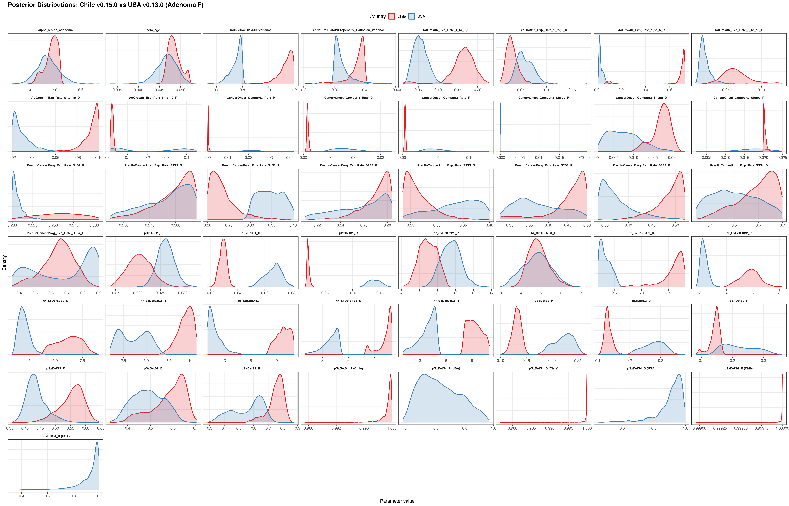{fig-align="center" width="95%"}

------------------------------------------------------------------------

## Calibration Targets — Numerical (Chile vs USA) {.smaller}

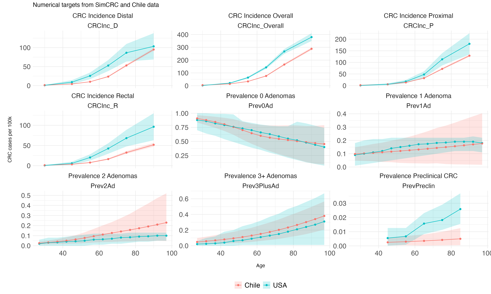{fig-align="center" width="95%"}

------------------------------------------------------------------------

## Calibration Targets — Categorical (Chile vs USA) {.smaller}

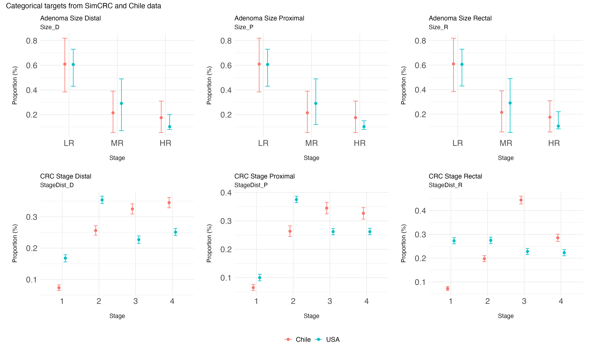{fig-align="center" width="90%"}

------------------------------------------------------------------------

## Coverage Analysis — Numerical Targets {.smaller}

LHS coverage for CRC incidence (overall, proximal, distal, rectal), adenoma prevalence (0–3+ lesions), and preclinical prevalence.

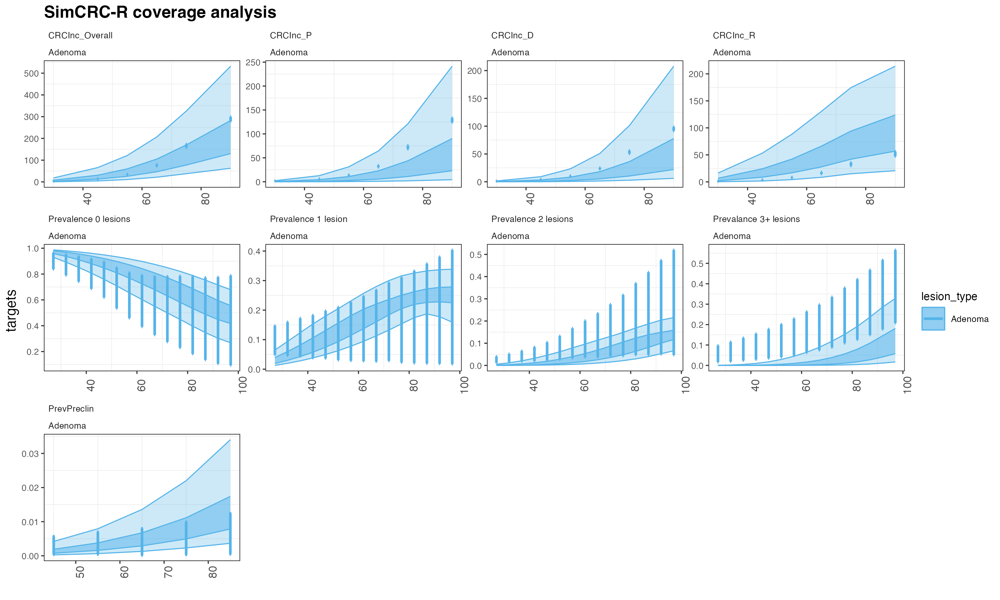{fig-align="center" width="90%"}

------------------------------------------------------------------------

## Coverage Analysis — Categorical Targets {.smaller}

LHS coverage for stage distribution and size distribution by location (proximal, distal, rectal).

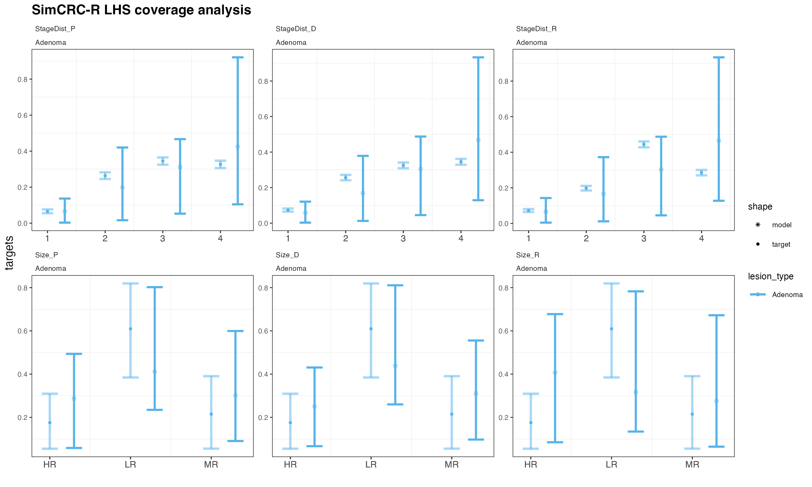{fig-align="center" width="85%"}

------------------------------------------------------------------------

## ANN Prediction Performance

Neural network predicted vs. actual model outputs across all calibration targets.

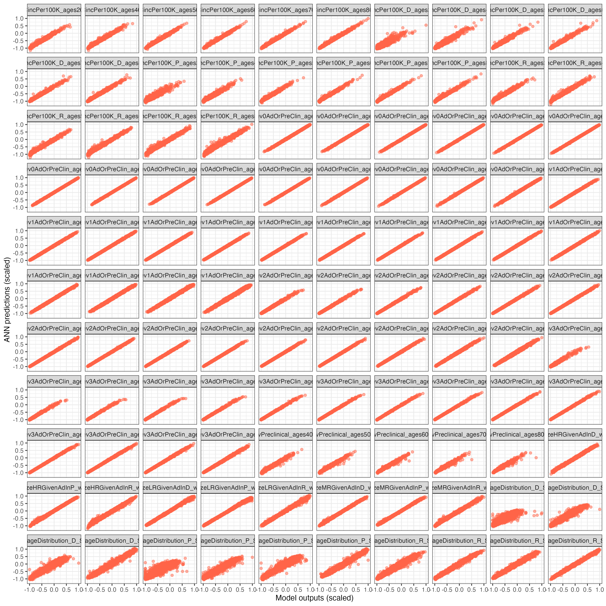{fig-align="center" width="85%"}

------------------------------------------------------------------------

## Prior vs Posterior Distributions

Comparison of prior (purple) and posterior (gold) distributions for all calibrated parameters.

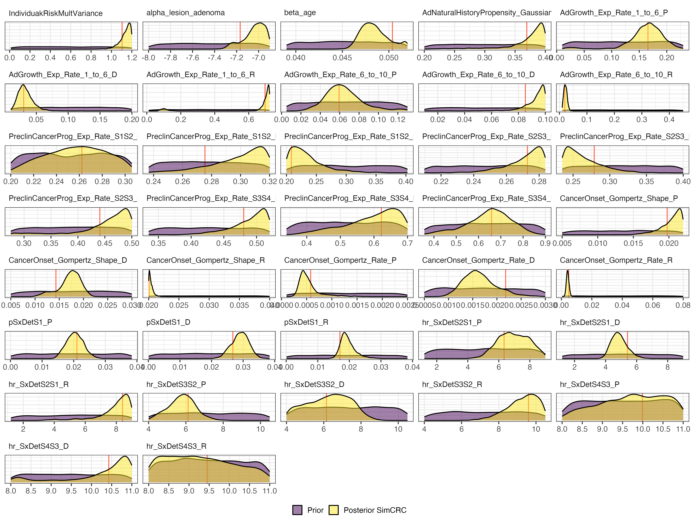{fig-align="center" width="95%"}

------------------------------------------------------------------------

## Posterior Distribution by Chain

Chain-level posterior densities — checking convergence across the 4 MCMC chains.

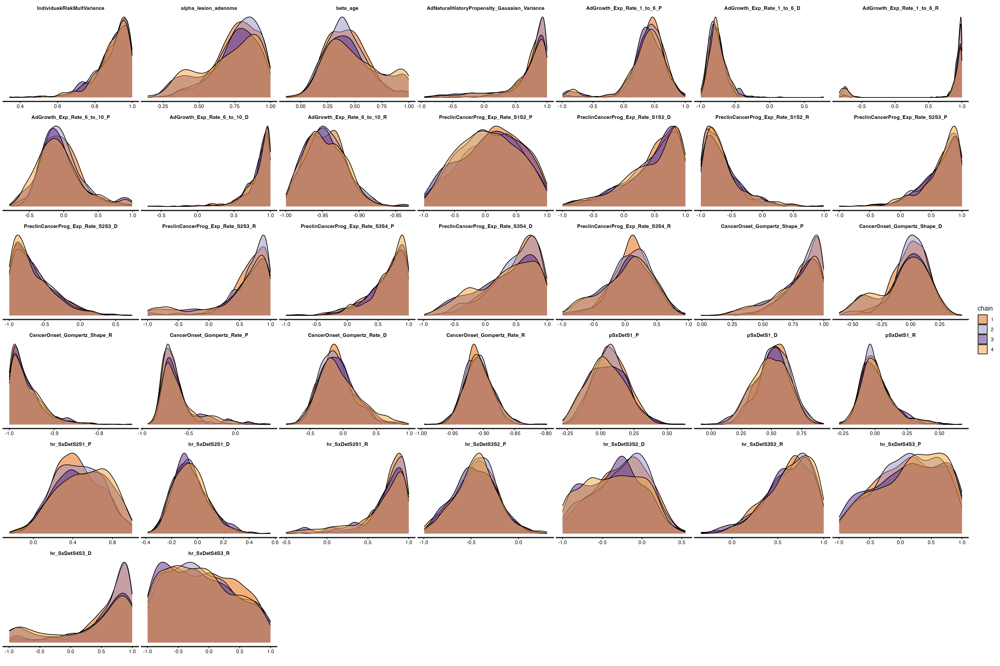{fig-align="center" width="95%"}

------------------------------------------------------------------------

## Internal Validation — Numerical Targets {.smaller}

Posterior validation for CRC incidence and adenoma prevalence targets across age.

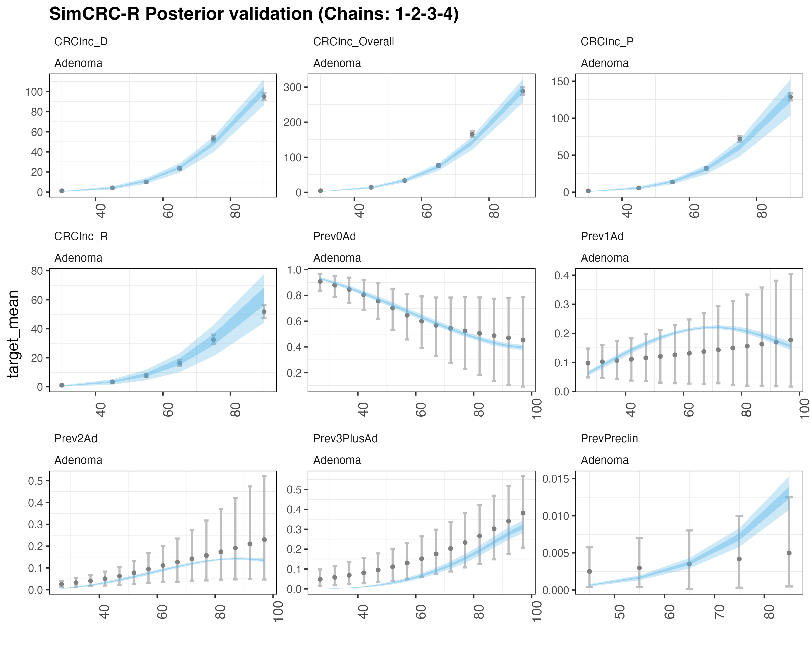{fig-align="center" width="90%"}

------------------------------------------------------------------------

## Internal Validation — Categorical Targets {.smaller}

Posterior validation for size distribution and stage distribution targets.

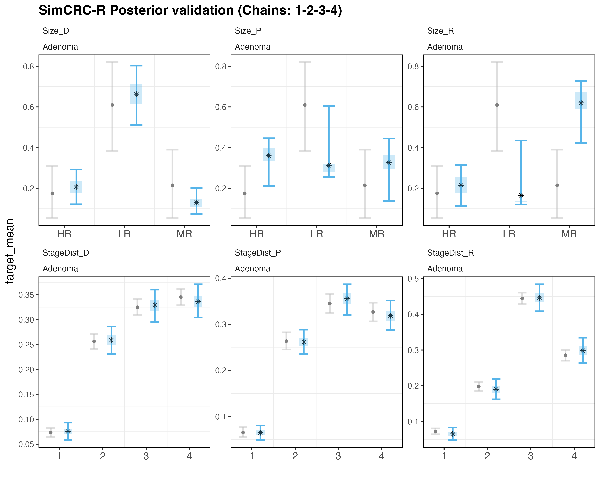{fig-align="center" width="85%"}

------------------------------------------------------------------------

## Symptom Detection — Chile vs USA {.smaller}

United States = published SimCRC US model v0.13.0.1. Chile = v0.15.0. Both use the Min_AbsolutErr set.

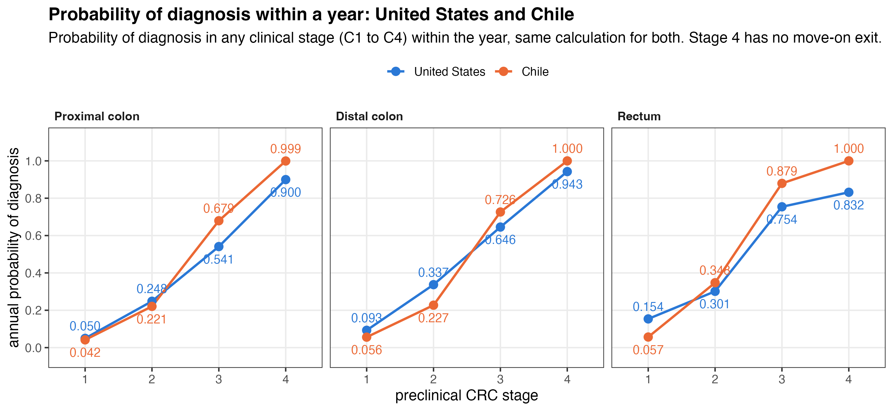{fig-align="center" width="92%"}

------------------------------------------------------------------------

## Symptom Detection — Numbers {.smaller}

United States = published SimCRC US model v0.13.0.1. Chile = v0.15.0. Both use the Min_AbsolutErr set.



------------------------------------------------------------------------

## Screening Cost Update — v2 vs v3 (CLP) {.smaller}

Updated to 2026 Chilean costs (`screen_costs_v3.csv`). Key changes:

| Procedure | v2 | v3 | Change |
|---|---:|---:|---:|
| FIT | 14,220 | 21,510 | +51% |
| SIG | 77,100 | 118,064 | +53% |
| Screening colonoscopy (no polypectomy) | 121,664 | 181,271 | +49% |
| Diagnostic colonoscopy (no polypectomy) | 105,885 | 157,762 | +49% |
| Surveillance colonoscopy (no polypectomy) | 119,993 | 178,781 | +49% |
| Colonoscopy with polypectomy | 144,028 | 426,078 | +196% |
| Fatal perforation | 1,134,170 | 3,355,203 | +196% |
| Serious GI complication | 1,134,170 | 3,355,203 | +196% |
| Other GI complication | 808,045 | 2,390,433 | +196% |
| Cardiovascular complication | 885,641 | 2,619,984 | +196% |

------------------------------------------------------------------------

## Final Results — Cost-Effectiveness Frontiers (v0.15.0) {.smaller}

::: columns
::: {.column width="50%"}
**All 68 strategies**

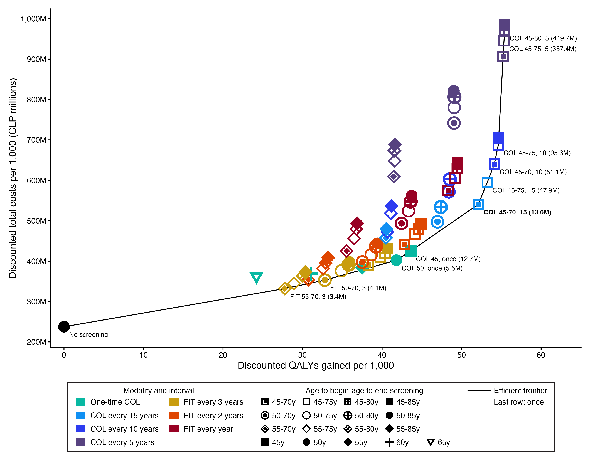{fig-align="center" width="100%"}
:::

::: {.column width="50%"}
**FIT strategies only**

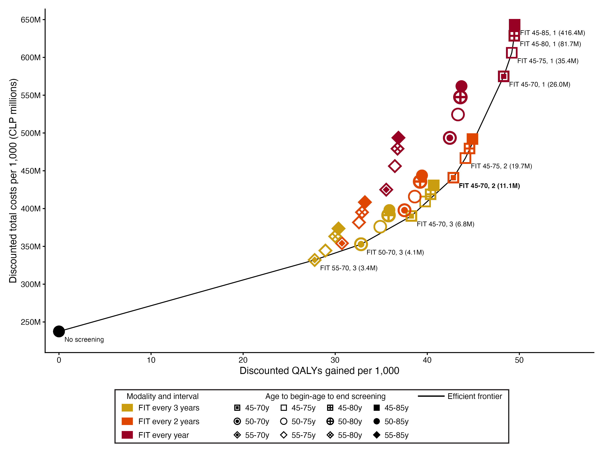{fig-align="center" width="100%"}
:::
:::

------------------------------------------------------------------------

## Final Results — Choice at 16M CLP per QALY {.smaller}



68 strategies, 1,000,000 followed from age 40.

------------------------------------------------------------------------

## Final Results — Costs, QALYs and Deaths Averted {.smaller}



Per 1,000 people followed from age 40. Costs in CLP. COL = colonoscopies.
