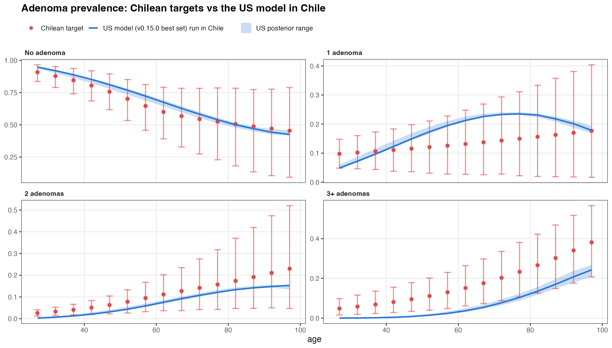
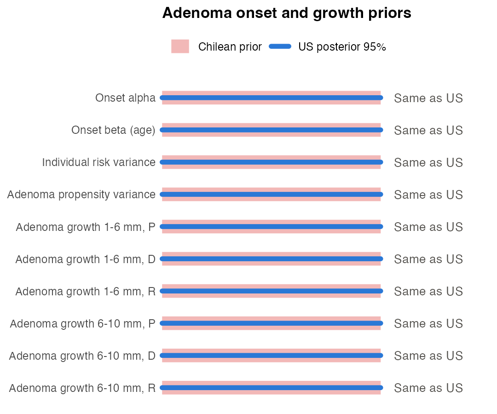
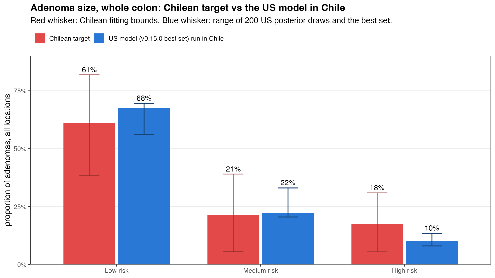
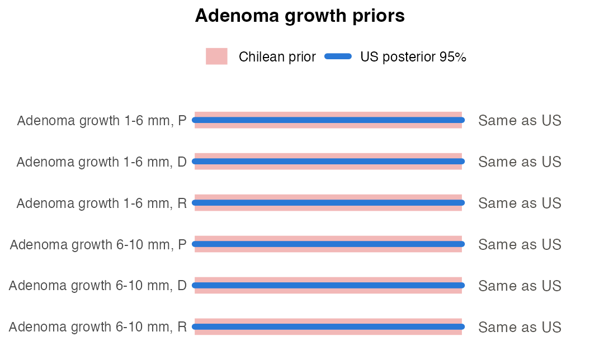
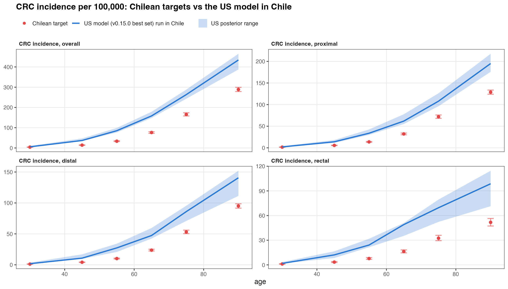
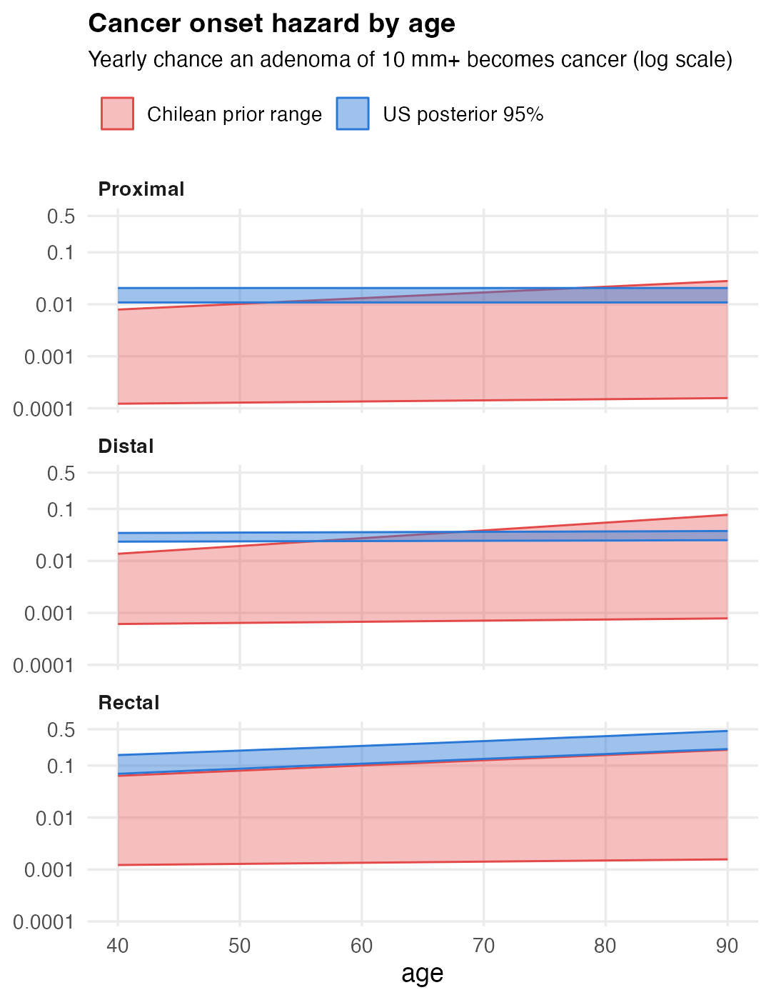
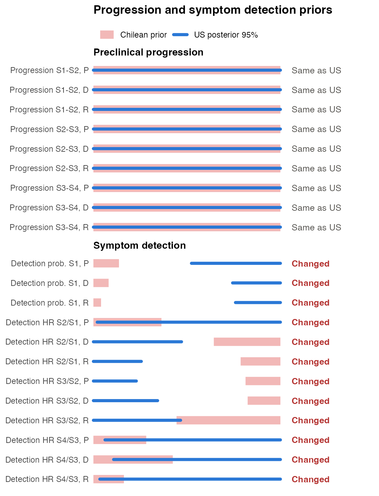
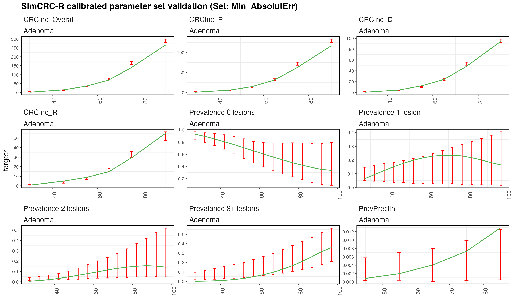
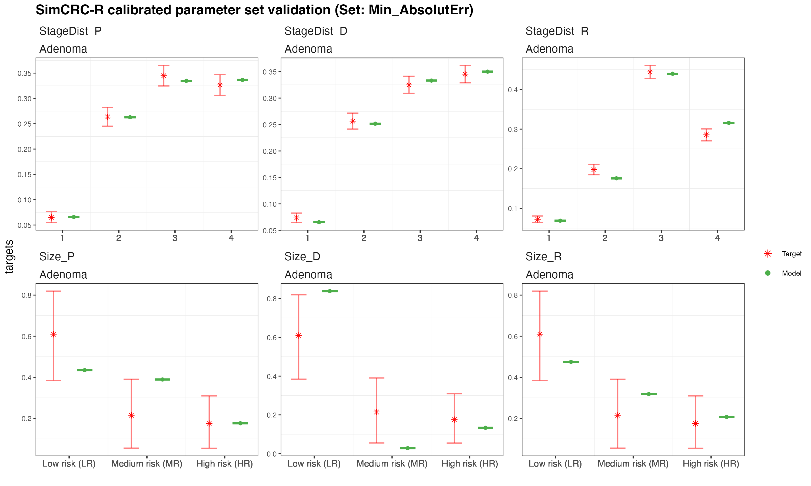
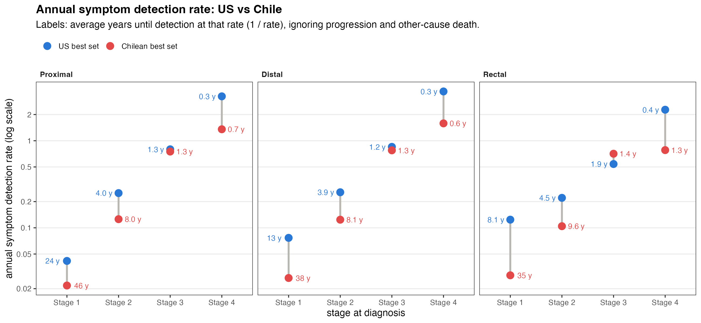

## Our approach: keep the validated US model

Because we don't have Chilean screening trial to validate the Chilean model, we take as much as possible from the US model, which has been validated, and change only what the Chilean targets clearly show is different.

In the natural history we change just two things, and we feel that both can be defended from the targets:

- **Slower cancer onset.** Chile and the US have about the same number of adenomas, and a similar adenoma size distribution, but Chile has much less colorectal cancer. Slower adenoma growth could also make less cancer, but we would expect to see more small adenomas if this was the case. So we assume adenomas turn into cancer more slowly in Chile.
- **Slower symptom detection** (less certain). More Chilean cancers are found at stage 3 or 4. Our hypothesis, after discussing with Nicolás, is that a known backlog of colonoscopies for people with symptoms delays diagnosis in Chile. This seems like a reasonable explanation, but not the only one.

Everything else (adenoma onset, adenoma growth and how cancers progress before diagnosis) comes from the US posterior.

::: {.notes}
Agreed with Nicolás: the two Chile-specific assumptions are lower cancer onset rates and slower symptom detection rates. The symptom detection assumption is a hypothesis; other explanations (for example later presentation or symptom awareness) could also contribute.
Why cancer onset rather than adenoma growth: both could lower CRC incidence, but slower growth would shift adenomas to smaller sizes, and the Chilean size target is close to what the US model gives (whole colon: 61% low risk vs 68% in the US model run in Chile).
Cancer onset evidence: adenoma prevalence targets are similar in the two countries (proportion with no adenoma at age 62: Chile 0.60, US 0.66), while CRC incidence in Chile is about half the US in midlife (76 vs 143 per 100,000 at ages 60 to 69).
Symptom detection evidence: stage 3 and 4 make up 67 to 73% of Chilean cancers vs 45 to 52% in the US; stage 1 is about 7% in Chile vs 10 to 27% in the US.
Symptom detection is the only part of cancer behaviour we vary, because access to diagnostic colonoscopy is a health-system difference, not a difference in the biology of the disease.
:::
## What changes from the US, and why

| Model part | Chilean model | Why |
|:---|:---|:---|
| Background mortality | Chile 2017 life table | Deaths from other causes are specific to the Chilean population |
| Adenoma onset and growth | **Same as US** (middle 95% of the US posterior) | The US model is validated; Chilean adenoma prevalence is close to what the US model gives |
| Cancer onset | **Changed:** slower than the US | About the same number and size of adenomas, but much less CRC |
| Preclinical progression | **Same as US** (middle 95% of the US posterior) | How cancer grows before diagnosis is biology; we assume it is the same in both countries |
| Symptom detection | **Changed:** slower than the US | We assume cancers are found at later stages in Chile because there is a known backlog of colonoscopies for symptom detection |
| CRC survival | **Adjusted:** a more recent relative survival year | Fits a Chilean estimate of 5-year overall survival |

::: {.notes}
Chilean priors as in "Second attempt at calibrating SimCRC v0.15" in analysis/calibration/01_calibration_setup.R: adenoma onset (alpha, beta, individual risk variance, adenoma propensity variance), adenoma growth and preclinical progression use the 2.5th to 97.5th percentiles of the US v0.15.0.20261026.130537 posterior.
Cancer onset (Gompertz shape and rate, P, D, R) uses Chilean ranges below the US posterior, with upper bounds raised 15%.
Symptom detection: priors set a priori from the Chilean stage targets, with every annual detection rate at or below the US posterior median, except rectal stage 3, capped at 0.72 per year (1.38x the US median of 0.52, US 92nd percentile).
CRC survival: relative survival from a more recent year than the simcrc default, chosen so model results fit a Chilean estimate of 5-year overall survival. Survival is not part of the natural-history calibration.
The results slides use the second attempt at calibrating SimCRC v0.15 (run v0.15.0.901.20261111.2051), which follows this table.
:::
## Adapting SimCRC to Chile

::: {style="font-size:1.5em; margin-top:1.2em; line-height:1.9"}
1. [Background mortality]{style="color:#8a8985"}
2. [Adenoma prevalence]{style="color:#8a8985"}
3. [CRC incidence]{style="color:#8a8985"}
4. [Stage at diagnosis]{style="color:#8a8985"}
5. [CRC survival]{style="color:#8a8985"}
:::
## Adapting SimCRC to Chile: background mortality

::: {style="font-size:1.5em; margin-top:1.2em; line-height:1.9"}
1. [**Background mortality**]{style="color:#2a78d6"}
2. [Adenoma prevalence]{style="color:#8a8985"}
3. [CRC incidence]{style="color:#8a8985"}
4. [Stage at diagnosis]{style="color:#8a8985"}
5. [CRC survival]{style="color:#8a8985"}
:::

We use the **2017 Chilean life table** for deaths from other causes. Source: [to add]

::: {.notes}
File: data-raw/df_lifetable_2017_CH.csv; race-specific mortality switched off. Chilean death rates are about 20 to 30% lower than US women in the 1977 life table used for the US calibration (ages 50 to 80).
:::
## Adapting SimCRC to Chile: adenoma prevalence

::: {style="font-size:1.5em; margin-top:1.2em; line-height:1.9"}
1. [Background mortality]{style="color:#8a8985"}
2. [**Adenoma prevalence**]{style="color:#2a78d6"}
3. [CRC incidence]{style="color:#8a8985"}
4. [Stage at diagnosis]{style="color:#8a8985"}
5. [CRC survival]{style="color:#8a8985"}
:::
## Adenoma prevalence: Chile vs the US model

:::: {.columns}
::: {.column width="66%"}
{width="100%"}
:::
::: {.column width="34%"}
{width="100%"}
:::
::::

**No change.** The US model run in Chile stays inside the Chilean bounds for no adenoma and 1 adenoma at every age. It gives fewer people with **3+ adenomas** (below the bounds until about age 80) and slightly fewer with 2 adenomas before 40. We keep the **US posterior** for adenoma onset and growth and accept this gap.

::: {.slide-note}
Source of the Chilean targets: [to add]
:::

::: {.notes}
Blue line: US v0.15.0.20261026.130537 Min_AbsolutErr set. Blue band: full range of 200 random US posterior draws plus the best set. All simulated in the Chilean population (2017 cohort, Chilean life table, 100,000 women, minimum lesion-onset age 15).
The right panel shows the Chilean priors (pink) against the middle 95% of the US posterior (blue); here they are identical.
Proportion of ages inside the Chilean bounds: no adenoma 100%, 1 adenoma 100%, 2 adenomas 80% (below at 27 to 37), 3+ adenomas 27% (below until 77, for example 0.04 vs 0.15 at 62; inside from 82).
The multiplicity gap is the price of keeping the US adenoma onset and growth; the Chilean multiplicity targets may also be less certain.
:::
## Adenoma size: Chile vs the US model

:::: {.columns}
::: {.column width="66%"}
{width="100%"}
:::
::: {.column width="34%"}
{width="100%"}
:::
::::

**No change.** The Chilean size target is **one value for the whole colon**, so we compare the whole colon. The US model stays inside the Chilean bounds for all three size classes. We keep the **US growth**, and with it the US differences in size by location, rather than assume size is the same everywhere.

::: {.slide-note}
Source of the Chilean targets: [to add]
:::

::: {.notes}
Size classes: low, medium and high risk adenomas among adenomas found at ages 50 to 75, weighted as in the calibration targets. The Chilean target is one value for the whole colon (61% low, 21% medium, 18% high risk), copied to the proximal, distal and rectal targets.
Whole colon, US best set run in Chile: 68% low, 22% medium, 10% high risk. Blue whisker: full range of 200 random US posterior draws plus the best set, so it always contains the bar. All inside the Chilean bounds (38 to 82%, 6 to 39%, 6 to 31%).
By location the US model differs a lot (low risk: proximal 61%, distal 86%, rectal 50%). Without location-specific Chilean data, keeping the US pattern is safer than assuming no difference by location; Mexico City made the same assumption.
The US best set (posterior draw 734) is in the tails of the US posterior for several parameters (for example proximal 1-6 mm growth at the 0.6th percentile), so its size output is near the edge of the posterior range.
An earlier calibration matched each location to the pooled target only by moving distal growth away from the US posterior (1-6 mm growth up to 0.20 vs US 0.010 to 0.013; 6-10 mm growth 0.01 to 0.1 vs US 0.14 to 0.62).
Source: slides/calibration2_2026-11-11/tables/adenoma_size_pooled_us_in_chile.csv.
:::
## Adapting SimCRC to Chile: CRC incidence

::: {style="font-size:1.5em; margin-top:1.2em; line-height:1.9"}
1. [Background mortality]{style="color:#8a8985"}
2. [Adenoma prevalence]{style="color:#8a8985"}
3. [**CRC incidence**]{style="color:#2a78d6"}
4. [Stage at diagnosis]{style="color:#8a8985"}
5. [CRC survival]{style="color:#8a8985"}
:::
## CRC incidence: Chile vs the US model

:::: {.columns}
::: {.column width="66%"}
{width="100%"}
:::
::: {.column width="34%"}
{width="100%"}
:::
::::

**Change: slower cancer onset.** With about the same adenomas, the US model gives Chile **1.5–2.6 times** the observed incidence. Chilean cancer onset rates are set below the US.

::: {.slide-note}
Source of the Chilean targets: [to add]
:::

::: {.notes}
Blue band: full range of 200 random US posterior draws plus the best set, run in the Chilean population. US best set run in Chile vs Chilean targets, overall incidence per 100,000: 37 vs 14 at ages 40 to 49, 85 vs 33 at 50 to 59, 158 vs 76 at 60 to 69, 263 vs 166 at 70 to 79, 434 vs 289 at 80 to 99.
Right panel: yearly hazard that an adenoma of 10 mm or more becomes cancer, rate x exp(shape x age), as in simcrc CRC_onset_risk. Blue: middle 95% of the US posterior. Pink: range allowed by the Chilean prior (Chilean Gompertz ranges with upper bounds raised 15%).
Shape and rate trade off: the Chilean ranges use a much lower rate with a higher shape, so the hazard starts low and rises faster with age. The shape being higher than the US is intended, not a typo.
The Chilean prior allows hazards well below the US at every age. For proximal and distal, its top corner can exceed the US from about age 70; the fitted Chilean values sit far below the US (Chilean best set, ages 50 to 80: proximal 0.003 to 0.004 per year vs the US best set's 0.016; distal 0.006 to 0.009 vs 0.029 to 0.031; rectal 0.012 to 0.014 vs 0.12 to 0.25).
:::
## Adapting SimCRC to Chile: stage at diagnosis

::: {style="font-size:1.5em; margin-top:1.2em; line-height:1.9"}
1. [Background mortality]{style="color:#8a8985"}
2. [Adenoma prevalence]{style="color:#8a8985"}
3. [CRC incidence]{style="color:#8a8985"}
4. [**Stage at diagnosis**]{style="color:#2a78d6"}
5. [CRC survival]{style="color:#8a8985"}
:::
## Stage at diagnosis: Chile vs the US model

:::: {.columns}
::: {.column width="66%"}
Proportion of diagnosed cancers by stage: Chilean targets and the US best set run in Chile.

::: {.mechanism-table}

:::
:::
::: {.column width="34%"}
{width="100%"}
:::
::::

**Change: slower symptom detection only.** The US model finds far more Chilean cancers at stage 1 (10–25% vs 7%) and too few at stage 3. We could change progression, symptom detection or both. We change **symptom detection only**, so the natural history stays the US one. Progression before diagnosis keeps the **US posterior**.

::: {.slide-note}
Source of the Chilean targets: [to add]
:::

::: {.notes}
Reason for symptom detection: less access to diagnostic colonoscopy for people with symptoms in Chile (an existing backlog) vs more capacity in the US. Agreed with Nicolas.
US model = the US v0.15.0 best set (Min_AbsolutErr) run in the Chilean population. US best set run in Chile, stage 1/2/3/4: proximal 10/41/26/23% vs targets 7/26/34/33%; distal 17/35/21/27% vs 7/26/32/35%; rectal 25/27/24/24% vs 7/20/44/29%.
The right panel shows the preclinical progression priors (identical to the US posterior) and the symptom detection priors (changed).
:::
## Adapting SimCRC to Chile: CRC survival

::: {style="font-size:1.5em; margin-top:1.2em; line-height:1.9"}
1. [Background mortality]{style="color:#8a8985"}
2. [Adenoma prevalence]{style="color:#8a8985"}
3. [CRC incidence]{style="color:#8a8985"}
4. [Stage at diagnosis]{style="color:#8a8985"}
5. [**CRC survival**]{style="color:#2a78d6"}
:::
## CRC survival

- We found an estimate of **5-year overall survival** for Chilean CRC patients.
- We compared it with model results under different relative survival assumptions.
- Assuming a **more recent relative survival year** fit the Chilean estimate better, so we use it.

::: {.slide-note}
Source of the Chilean survival estimate: [to add]
:::

::: {.notes}
Same approach as the Mexico City adaptation, which compared IMSS 5-year overall survival by stage with model results under 2003 and 2008 relative survival.
Survival after diagnosis is not a calibration target, so it does not change the natural-history calibration; it matters for the cost-effectiveness results.
:::
## Chile best set vs Chilean targets: incidence and prevalence {.image-slide}

{height="700px" fig-align="center"}

::: {.slide-note}
Chilean best set. Incidence per 100,000; prevalence as proportions. Red: Chilean targets and fitting bounds. Green: model.
:::

::: {.notes}
Second attempt at calibrating SimCRC v0.15, run v0.15.0.901.20261111.2051 (10,000 LHS draws, 4 chains, highest Rhat 1.003, no divergent transitions). Min_MSE and Min_AbsolutErr select the same draw (693).
Priors: US posterior middle 95% for adenoma onset, growth and progression; lower cancer onset; symptom detection set a priori from the Chilean stage targets (see "Second attempt at calibrating SimCRC v0.15" in analysis/calibration/01_calibration_setup.R).
Overall incidence per 100,000: in bounds at 40 to 49 (13.7 vs 14.1) and 60 to 69 (73.7 vs 76.3); low at 20 to 39 (2.0 vs 4.2) as in every calibration; slightly high at 50 to 59 (36.6 vs 33.5); low at 70 to 79 (135 vs 166) and just below the lower bound at 80 to 99 (272 vs 289).
Adenoma prevalence is inside the wide bounds; 3+ adenomas are low before about 60, as with the US model. Preclinical cancer prevalence is just above its bound at 80 to 89 (0.0132 vs 0.0125).
Parameters at a prior edge: adenoma onset alpha (top of the narrow US posterior range); rectal S3-S4 progression (bottom of the US posterior range); stage 1 detection in all three locations and the distal and rectal HR stage 2 vs 1 (top); rectal HR stage 3 vs 2 (top, the 0.72 cap).
:::
## Chile best set vs Chilean targets: stage and size {.image-slide}

{height="700px" fig-align="center"}

::: {.slide-note}
Chilean best set. Stage at diagnosis and adenoma size, as proportions. Red: Chilean targets and fitting bounds. Green: model.
:::

::: {.notes}
Stage at diagnosis, best set vs targets: proximal 0.07/0.26/0.34/0.33 vs 0.07/0.26/0.34/0.33 (all in bounds); distal 0.06/0.27/0.32/0.35 vs 0.07/0.26/0.32/0.35 (stage 1 just below its bound); rectal 0.08/0.21/0.42/0.28 vs 0.07/0.20/0.44/0.29 (stage 2 just above and stage 3 just below their bounds).
Every Chilean detection rate is below the US median rate at every stage and location, except rectal stage 3 (0.71 per year vs US median 0.52), which stays under the 0.72 cap and inside the US posterior range, as designed.
Adenoma size by location: rectal inside the bounds; proximal medium risk at its upper bound (0.391 vs 0.390); distal mostly low risk (0.84 vs upper bound 0.82), as expected with US growth (see the whole-colon size slide).
:::
## Dwell and sojourn time

Both best sets in the same Chilean population, with the Chilean life table, so the difference comes from the natural history only.

::: {.mechanism-table}

:::

- **Adenoma dwell is about 3 years longer** in Chile, because we assume slower **cancer onset**.
- **Sojourn is less than 1 year longer**, because cancer **progression is the same as the US** and only **symptom detection** is slower. A slower detection rate means that cancers take longer to be detected, which means more cancers are detected at a more advanced stage.

::: {.notes}
Both best sets run with calibration_out() in the Chilean calibration population (l_model_adenoma_Chile: Chilean 2017 life table, 2017 cohort, 100,000 women, minimum lesion onset age 15), with normal other-cause death. Means are over people whose cancer is diagnosed. In their own calibration populations the US set gives 26.4 / 3.5 / 29.9 years (US 1977 female life table) and the Chilean set 29.3 / 4.4 / 33.7.
Adenoma dwell: adenoma onset to preclinical cancer. Sojourn: preclinical cancer to symptom detection. Total dwell: adenoma onset to symptom detection.
Source: slides/calibration2_2026-11-11/tables/dwell_sojourn_best_sets.csv.
:::
## Symptom detection rates, best sets {.image-slide}

{width="100%"}

**Annual rate** at which an undiagnosed (preclinical) CRC is detected because of symptoms, in the absence of screening and of death from other causes.

::: {.notes}
Annual detection rates: r1 = -log(1 - pSxDetS1); each later stage multiplies the previous rate by its hazard ratio. Labels are 1 / rate: the average years until symptom detection at that rate if the cancer stayed in that stage.
Chile best set: run v0.15.0.901.20261111.2051. US best set: v0.15.0.20261026.130537 Min_AbsolutErr.
Table, US vs Chile annual rate by stage at diagnosis:
| Stage at diagnosis | Proximal US | Proximal Chile | Distal US | Distal Chile | Rectal US | Rectal Chile |
| :--- | ---: | ---: | ---: | ---: | ---: | ---: |
| Stage 1 | 0.042 | 0.022 | 0.077 | 0.027 | 0.124 | 0.028 |
| Stage 2 | 0.250 | 0.126 | 0.256 | 0.124 | 0.221 | 0.104 |
| Stage 3 | 0.797 | 0.751 | 0.851 | 0.776 | 0.540 | 0.709 |
| Stage 4 | 3.235 | 1.354 | 3.682 | 1.583 | 2.271 | 0.781 |
:::
