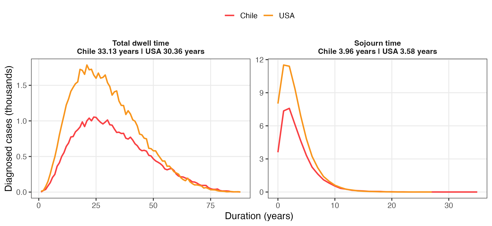

## USA R versus C++ natural history {.cheat-sheet-overview data-background-image="../outputs/comparison/USA_20261026_Chile_20260921/usa_vs_cpp/validation_cpp_r_USA_v0.15.0.20261026_MAE_f.png" data-background-size="contain" data-background-color="white" data-state="cheat-sheet-fullscreen"}

::: {.notes}
User-provided USA implementation comparison, using the October 26 v0.15.0 calibrated R parameter set and the C++ reference results.
Original figure and phase CSV are preserved unchanged in outputs/comparison/USA_20261026_Chile_20260921/usa_vs_cpp/.
Phase data: phase_dwell_time_USA_v0.15.0.20261026_MAE_f.csv.
This is a separate completed run: R USA has 61,394 diagnosed cases; C++ has 65,877.
The following Chile-USA comparison uses its own completed runs and diagnosed-case counts; the USA values differ slightly between those runs.
The phase CSV confirms that the four unrounded means sum to mean total dwell time for each model, without missing or out-of-order exclusions.
No simulations were rerun and the supplied figure was not edited.
:::

## Calibration inputs and scope

| Parameter source | Previous comparison | Updated comparison |
|:---|:---|:---|
| USA | Published set v0.13.0.1 | 26 October 2026, v0.15.0 |
| Chile | 21 September 2026, v0.15.0 | Same Chile set |

The cheat sheet compares the updated USA set with the September Chile set.

**Natural history:** one million simulated women per country, without screening.

**Life tables:** Chile 2017 and USA 1977, preserving the original cheat-sheet assumptions.

::: {.slide-note}
Both countries use the female adenoma model. Adenomas are precancerous polyps.
The cheat sheet uses the parameter sets selected for the smallest absolute calibration error.
:::

::: {.notes}
Code: analysis/figures/11_cheat_sheet_Chile_vs_USA.R. Slide assets: analysis/figures/13_calibration_update_slides.R.
Chile run: v0.15.0.20260921.1018. Updated USA run: v0.15.0.20261026.130537.
Cheat-sheet selection: Min_AbsolutErr for both countries. Installed simcrc code is v0.15.0.
The cheat sheet uses selected parameter sets. The validation figures summarize completed simulations across four calibration sampling chains.
:::

## Chile internal validation: numerical targets {.calibration-validation data-background-image="../outputs/BayCANN_versions/Chile/Adenoma/F/v0.15.0/v0.15.0.20260921.1018/fig_internal_validation_SimCRC_v0.15.0.20260921.1018_Adenoma_F_num.png" data-background-size="contain" data-background-position="right center" data-background-color="white" data-state="validation-fullscreen"}

::: {.validation-label}
**Chile calibration**

21 September 2026
v0.15.0

**Numerical targets**

Incidence per 100,000.

Prevalence as proportions.

Four parallel calibration sampling runs.

Grey: targets and fitting bounds.

Blue: calibrated model simulations and their spread.
:::

::: {.notes}
Original internal-validation figure from the Chile run v0.15.0.20260921.1018, female adenoma model.
Source image: ../outputs/BayCANN_versions/Chile/Adenoma/F/v0.15.0/v0.15.0.20260921.1018/fig_internal_validation_SimCRC_v0.15.0.20260921.1018_Adenoma_F_num.png.
These are completed posterior simulations across calibration chains 1, 2, 3 and 4, not the single selected parameter set.
Blue summaries show empirical middle 50% and 95% ranges across simulations. Grey target whiskers are calibration stopping bounds.
Numerical incidence is per 100,000 and prevalence is a proportion. Categorical size and stage distributions are proportions.
These figures compare results with the targets used for fitting. They do not establish independent external validation.
No calibration or simulations were rerun to include these images. October 26 USA internal-validation images were not found in the checked repositories.
:::

## Chile internal validation: categorical targets {.calibration-validation data-background-image="../outputs/BayCANN_versions/Chile/Adenoma/F/v0.15.0/v0.15.0.20260921.1018/fig_internal_validation_SimCRC_v0.15.0.20260921.1018_Adenoma_F_cat.png" data-background-size="contain" data-background-position="right center" data-background-color="white" data-state="validation-fullscreen"}

::: {.validation-label}
**Chile calibration**

21 September 2026
v0.15.0

**Categorical targets**

Polyp size and cancer-stage proportions.

Four parallel calibration sampling runs.

Grey: targets and fitting bounds.

Blue: calibrated model simulations and their spread.
:::

::: {.notes}
Original internal-validation figure from the Chile run v0.15.0.20260921.1018, female adenoma model.
Source image: ../outputs/BayCANN_versions/Chile/Adenoma/F/v0.15.0/v0.15.0.20260921.1018/fig_internal_validation_SimCRC_v0.15.0.20260921.1018_Adenoma_F_cat.png.
These are completed posterior simulations across calibration chains 1, 2, 3 and 4, not the single selected parameter set.
Blue summaries show empirical middle 50% and 95% ranges across simulations. Grey target whiskers are calibration stopping bounds.
Numerical incidence is per 100,000 and prevalence is a proportion. Categorical size and stage distributions are proportions.
These figures compare results with the targets used for fitting. They do not establish independent external validation.
No calibration or simulations were rerun to include these images. October 26 USA internal-validation images were not found in the checked repositories.
:::

## Natural-history cheat sheet {.cheat-sheet-overview data-background-image="../outputs/comparison/USA_20261026_Chile_20260921/cheat_sheet/cheat_sheet_Chile_USA_v0.15.0.png" data-background-size="contain" data-background-color="white" data-state="cheat-sheet-fullscreen"}

::: {.notes}
This is the completed original-code cheat sheet, including the four phase means in the Mean column.
Updated USA calibration and September Chile calibration. One million simulated women per country.
The next slides enlarge the duration distributions and phase means.
Code: analysis/figures/11_cheat_sheet_Chile_vs_USA.R. Selected sets: USA v0.15.0.20261026.130537 and Chile v0.15.0.20260921.1018.
Original country life tables and minimum lesion-onset age 10 are retained.
:::

## Dwell time and sojourn time {.image-slide}

**Total dwell:** polyp formation to symptomatic diagnosis.
**Sojourn:** cancer onset to symptomatic diagnosis.

{width="100%"}

::: {.slide-note}
Means describe the polyp that triggered diagnosis: 40,159 Chile cases and 61,601 USA cases.
:::

::: {.notes}
The histograms use the saved completed simulations. Each displayed mean uses precise event ages before the chart groups durations into whole years.
Country life tables differ, so these results do not isolate a parameter-only effect.
Source: cheat_sheet/natural_history_plot_data.rds and natural_history_summary.csv under outputs/comparison/USA_20261026_Chile_20260921.
:::

## Phases of dwell time

Each interval is calculated within the same diagnosing polyp before averaging across cases.

::: {.mechanism-table .phase-values}

:::

Chile's longer total interval mainly comes from the **large-adenoma phase**, partly offset by its shorter early growth phases.

::: {.slide-note}
The four phases sum to total dwell time. The general growth panels include different groups of polyps.
:::

::: {.notes}
Small = age_to_6mm minus age_lesion_onset. Medium = age_to_10mm minus age_to_6mm.
Large = age_crc minus age_to_10mm. Sojourn = age_dx_symp minus age_crc.
All four phase means use the same diagnosed-case counts: Chile 40,159 and USA 61,601.
Chile: 5.03 + 7.82 + 16.32 + 3.96 = 33.13 years. USA: 9.36 + 8.26 + 9.16 + 3.58 = 30.36 years.
Source: phase_duration_means.csv and natural_history_summary.csv. No new simulation or calibration was run.
:::
