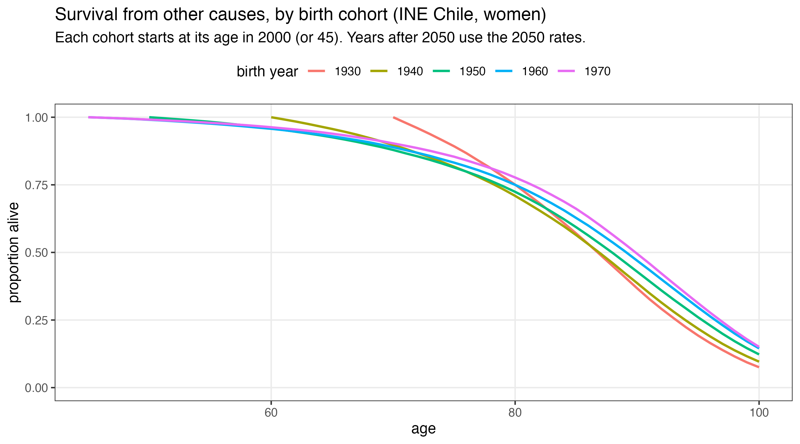
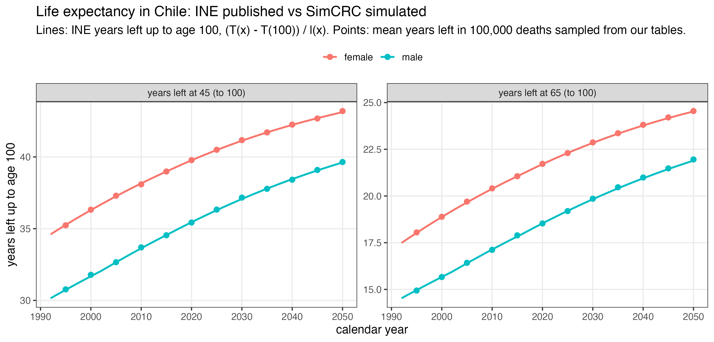

## Overview

**Goal:** run SimCRC for many birth cohorts at once, so results can be read by calendar year (for example, colonoscopy demand per year).

**Method:** Claudia's Mexico City multi-cohort setup, adapted to Chile.

::: incremental
- Birth-cohort grid: which cohorts a program needs
- One life table per birth cohort, from INE Chile 1992–2050
- Check: SimCRC reproduces INE life expectancy
- Decisions needed before the natural-history runs
:::

------------------------------------------------------------------------

## Plan and status {.smaller}

Claudia's plan for the multi-cohort model:

| # | step | status |
|:-:|:-----|:-------|
| 1 | Pick the program years, which fix the birth cohorts | **open**: needs Fernando and Nicolás |
| 2 | Birth-cohort grid | **done** |
| 3 | Birth-cohort life tables from INE | **done**, checked against INE |
| 4 | Population weights per cohort | **open**: needs the INE national projections |
| 5 | `get_dt_population()`: keep `byear`, drop `year` | **checked**, not started |
| 6 | Natural history per birth cohort (NordICC wrapper) | **open** |

------------------------------------------------------------------------

## Which birth cohorts? {.smaller}

Birth year = program year − age, for every age in the program (45 to 99).

| age | 2000 | 2001 | … | 2019 |
|:----|-----:|-----:|:-:|-----:|
| 45  | 1955 | 1956 | … | 1974 |
| 46  | 1954 | 1955 | … | 1973 |
| …   | …    | …    | … | …    |
| 99  | 1901 | 1902 | … | 1920 |

A 20-year program needs **74 birth cohorts**: 1901 to 1974 for a 2000–2019 program.

Same method as Claudia's Mexico City run: a 2025–2044 program needed 74 cohorts, 1926 to 1999.

Program years are a **placeholder** until we agree on them.

------------------------------------------------------------------------

## One life table per birth cohort

{fig-align="center" width="88%"}

Each cohort follows INE death rates along its own years: a woman born in 1960 meets the 2020 rate at age 60. Later cohorts live longer.

------------------------------------------------------------------------

## Check: SimCRC reproduces INE

{fig-align="center" width="90%"}

Deaths sampled with `get_dt_population()` match INE years left at 45 and 65 within about 0.1 years, 1995–2050.

------------------------------------------------------------------------

## Assumptions

::: incremental
- Rates are national (`País`) m(x) from the INE tables 1992–2050
- Each cohort enters at its age in the first program year, or at 45
- Years after 2050 keep the 2050 rates
- Everyone dies by 100, as in SimCRC, so we compare with INE years lived up to 100
- Cohorts are not yet weighted by population size
:::

------------------------------------------------------------------------

## Population weights per cohort {.smaller}

Each birth cohort is simulated with the same number of people, then weighted by its real size.

::: incremental
- **Weight:** women in the cohort when it enters the program (as in Claudia's Mexico "Census File")
  - cohorts entering at 45: women aged 45 in that year
  - older cohorts: women at their age in the first program year
- **Source needed:** INE national estimates and projections 1992–2050, by sex and single age to 100+
- **What we have:** a file for 33 Biobío communes only, ages to 80+, from 2002; not usable for national weights
:::

------------------------------------------------------------------------

## Decisions needed

::: incremental
- **Program years:** which years and how long? They fix the cohorts.
- **Life tables:** one table per cohort, or one table for everyone to start?
- **Population weights:** INE national projections 1992–2050 by single age?
- **Age 100:** keep SimCRC's cap?
- **Calibration** for the natural-history runs: v0.15.0 or the new run?
:::

------------------------------------------------------------------------

## Next steps

::: incremental
- Population weights per birth cohort (INE projections)
- Natural history for each birth cohort, from Claudia's NordICC wrapper
- simcrc: keep `byear`, drop `year` in `get_dt_population()` (calendar year = birth year + age, and the model never reads `year`)
- simcrc: fix one-row life tables and `screening_by_year` with stacked cohorts
:::
