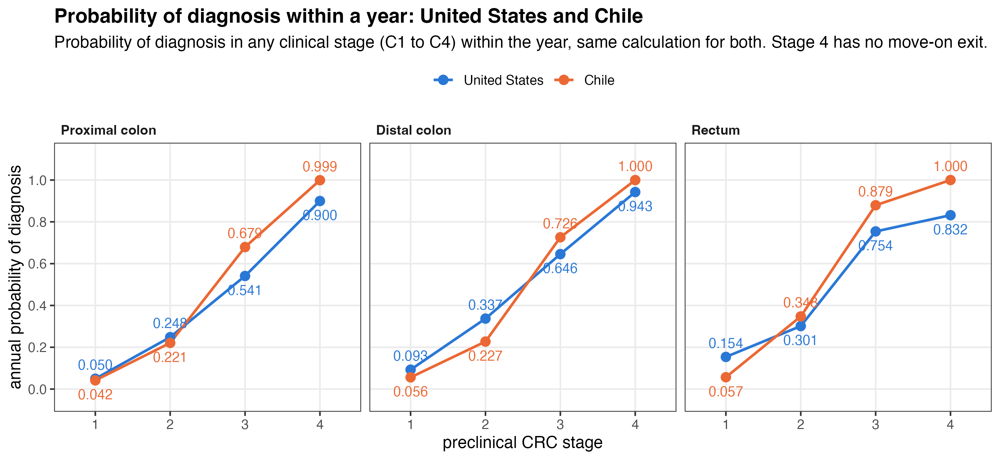
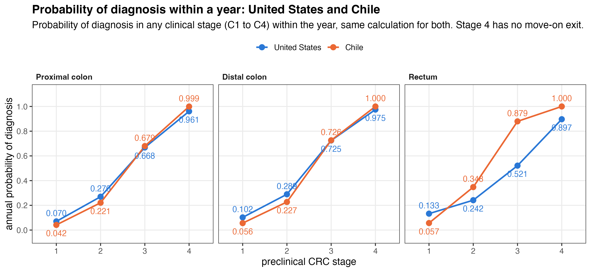
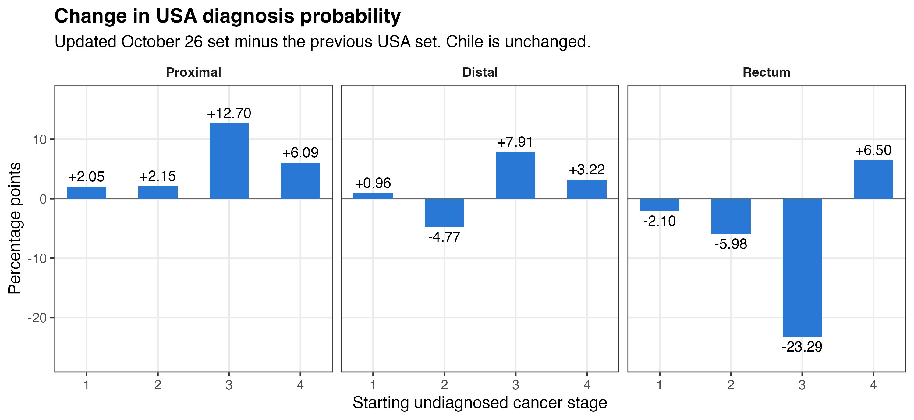

## Comparison inputs

| Parameter source | Previous comparison | Updated comparison |
|:---|:---|:---|
| USA | Published set v0.13.0.1 | 26 October 2026, v0.15.0 |
| Chile | 21 September 2026, v0.15.0 | Same Chile set |

Both comparisons use the female adenoma model and parameter sets selected for the smallest absolute calibration error.

**Reported probability:** diagnosis within one year, starting in an undiagnosed cancer stage.

The calculation allows cancer to advance and then trigger diagnosis during the same year.

::: {.slide-note}
The same original calculation is used throughout. Screening and deaths from other causes are excluded.
:::

::: {.notes}
Code: analysis/figures/plot_sx_competing_risk.R, orchestrated by analysis/figures/12_compare_transition_probabilities.R.
Chile run: v0.15.0.20260921.1018. Updated USA run: v0.15.0.20261026.130537.
Selection: Min_AbsolutErr for both countries. Installed simcrc code is v0.15.0 in both comparisons.
The original 8-state rate matrix has four undiagnosed and four diagnosed states. Progression and diagnosis compete as exits.
Diagnosis probabilities sum all diagnosed destinations in the one-year matrix exponential. These are selected-set calculations without parameter uncertainty.
:::

## Previous country comparison {.image-slide}

USA: published v0.13.0.1. Chile: September 2026 calibration.

{width="100%"}

::: {.notes}
Recomputed using the original script and packaged USA female Min_AbsolutErr set.
Source data: outputs/comparison/USA_20261026_Chile_20260921/transition_probabilities/previous/tables/diagnosis_probabilities_US_Chile.csv.
Stage-four probabilities displayed as 1.000 for Chile are rounded values below one.
:::

## Updated country comparison {.image-slide}

USA: October 2026 calibration. Chile: the same September 2026 calibration.

{width="100%"}

::: {.notes}
Only the USA parameter set changes. Country colours, probability calculation and chart axes are identical to the previous slide.
Source data: outputs/comparison/USA_20261026_Chile_20260921/transition_probabilities/updated/tables/diagnosis_probabilities_US_Chile.csv.
:::

## Change in USA diagnosis probability {.image-slide}

One percentage point means an absolute probability difference of 0.01.

{width="100%"}

::: {.notes}
Updated minus previous USA probability, multiplied by 100. Chile is unchanged.
Source: outputs/comparison/USA_20261026_Chile_20260921/transition_probabilities/diagnosis_probability_comparison.csv.
:::

## Diagnosis within one year

::: {.comparison-table}

:::

::: {.slide-note}
Probabilities are conditional on the starting stage. Change is updated minus previous USA probability, in percentage points (pp).
:::

::: {.notes}
The displayed probabilities are rounded to one decimal percent; changes are computed before rounding.
Source: outputs/comparison/USA_20261026_Chile_20260921/transition_probabilities/diagnosis_probability_comparison.csv.
:::

## Rectal stage 3

The USA diagnosis probability changes from **75.4% to 52.1%**, a decrease of **23.29 percentage points**.

::: {.mechanism-table}

:::

Both the diagnosis rate and progression rate change in the updated USA set.

::: {.slide-note}
A rate describes how quickly an event occurs. The annual probability reflects both events together, including progression followed by diagnosis.
:::

::: {.notes}
This example shows both exits rather than attributing the probability change to one input alone.
Source: previous and updated diagnosis_probabilities_US_Chile.csv exports and rectal_stage_3_example.md.
These are model calculations, not observed patient diagnosis probabilities.
:::
